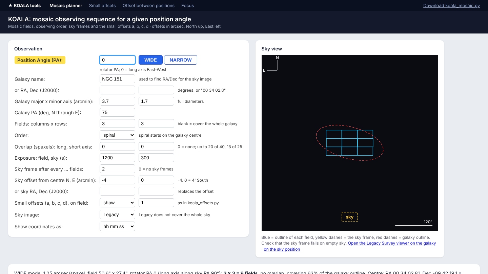

# KOALA observing tools

Small tools for planning and running observations with **KOALA**, the integral-field unit on the 3.9 m Anglo-Australian Telescope (AAT).

Every tool works in two ways:

- **In the browser, nothing to install:** open the website
  `https://vkansal9.github.io/koala-tools/`.
- **On your own computer:** download a script and run it with Python. It
  opens in your web browser and also works offline at the telescope.



## The tools

| Tool | Script | What it does |
|---|---|---|
| Mosaic planner | [`tools/koala_mosaic.py`](tools/koala_mosaic.py) | Tiles a galaxy with KOALA fields for a position angle: observing order, sky frames, offsets from the centre, RA/Dec of every pointing, and the small offsets a, b, c, d over the galaxy. |
| Small offsets | [`tools/koala_offsets.py`](tools/koala_offsets.py) | Offsets c -> a, a -> b, b -> c and b -> d (arcsec) for a position angle, WIDE or NARROW. |
| Offset between positions | [`tools/offset_positions.py`](tools/offset_positions.py) | North/South and East/West offset (arcsec) from one RA/Dec to another. |
| Focus | [`tools/koala_focus.py`](tools/koala_focus.py) | Parabola fit to FWHM against focus value: best focus and seeing. |

## Run on your own computer

You need **Python 3.8 or newer** and nothing else: the tools use only the
standard library.

```bash
# get everything (or download a single file from the tools folder)
git clone https://github.com/vkansal9/koala-tools.git
cd koala-tools

python tools/koala_mosaic.py 
```

The tool opens in your browser. Press `Ctrl+C` in the terminal to stop it.

Without internet everything still works except the background sky images and the galaxy-name look-up; type RA and Dec instead.

## Conventions

- Offsets are in arcsec; positive N = North, positive E = East.
- Position angle counts from North through East. At rotator PA 0 the long axis of the KOALA field (1.25" WIDE or 0.7" NARROW) runs East–West, the same convention as the small-offsets tool.

## How the website works

The website is plain static files served by GitHub Pages. Each tool page loads [Pyodide](https://pyodide.org) (Python compiled to WebAssembly) and runs the **same, unchanged** script from `tools/` inside the browser; `assets/bridge.py` hands the form to the script's own web handler instead of a local server. All calculations run on the visitor's machine.

```
index.html          home page
mosaic.html  ...    one page per tool (runs tools/<name>.py in the browser)
tools/              the Python tools; each also runs on its own
assets/             browser runner (runner.js, bridge.py, boot.css)
screenshots/        images for this README and the home page
```

To add a tool: put `my_tool.py` in `tools/` (it needs a `Handler` class with `do_GET`, like the others), copy one of the tool pages to
`my_tool.html` and set `data-tool="my_tool"`, then add it to the list in `assets/runner.js` and to `index.html`.

## Publish your own copy

1. Fork this repository (or create a new one and upload these files).
2. In the repository go to **Settings → Pages**, choose **Deploy from a branch**, branch **main**, folder **/ (root)**, and save.
3. After a minute the site is live at `https://<your-username>.github.io/<repository-name>/`.

## Credits

- **Small offsets**, **offset between positions** and **focus**: adapted from the KOALA observing scripts used at the AAT. The focus script is by Ángel R. López-Sánchez (AAO/MQU), version 1.1, 2018. These remain the work of their original authors.


This is an independent, unofficial collection; it is not run or endorsed by the AAT or its operators. Check offsets against the telescope's own procedures before observing.

## Licence

See [LICENSE](LICENSE).
